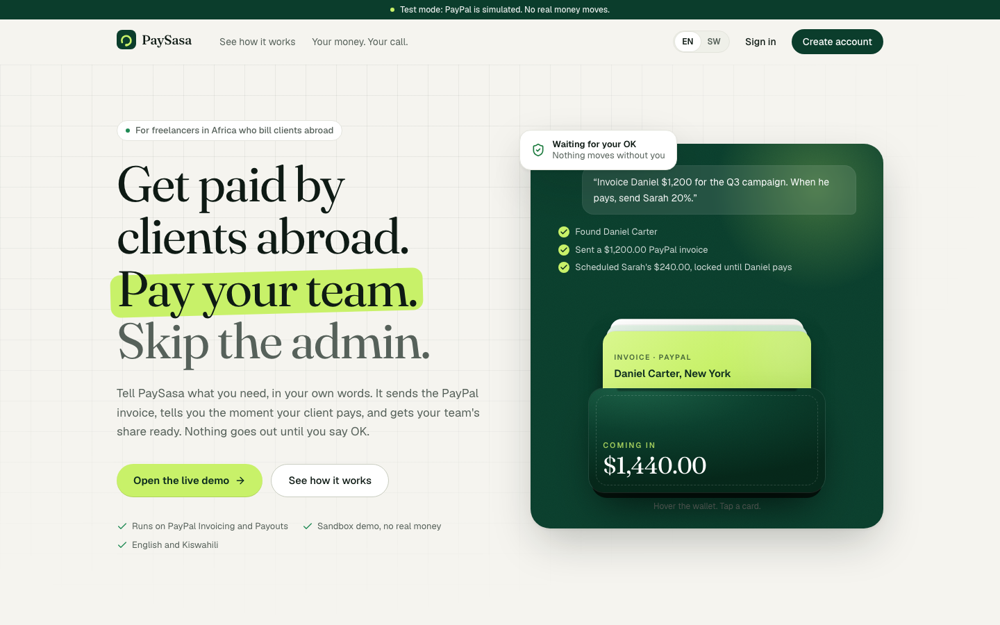
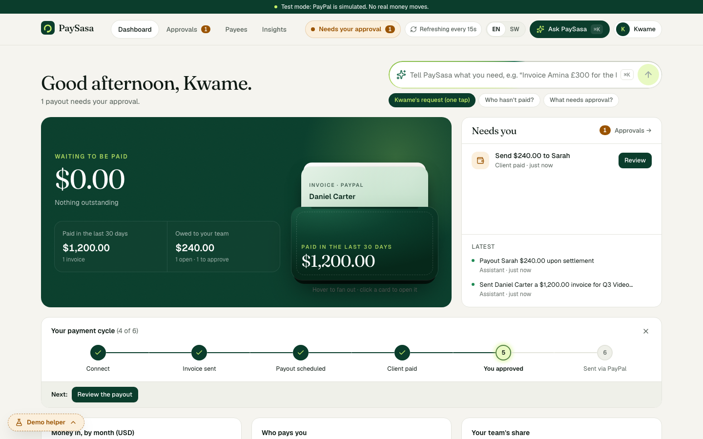
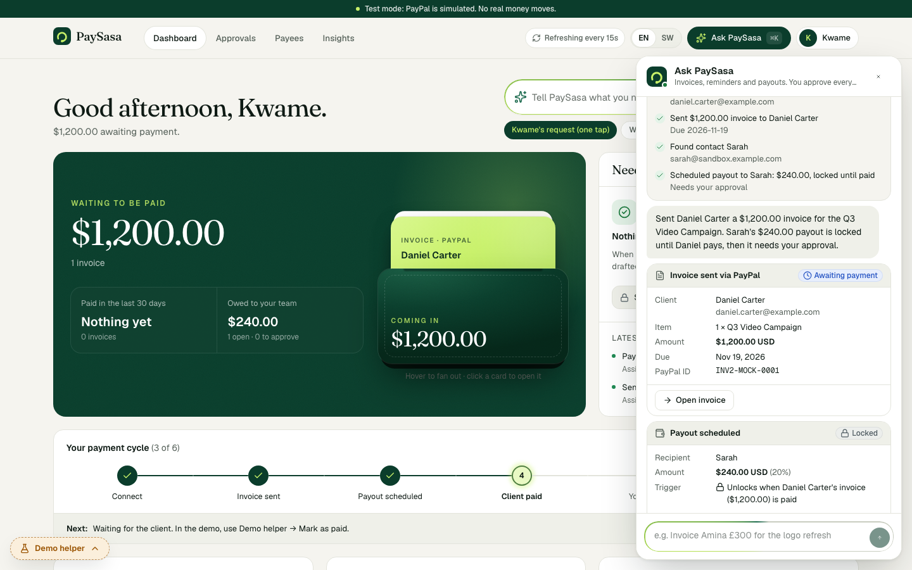
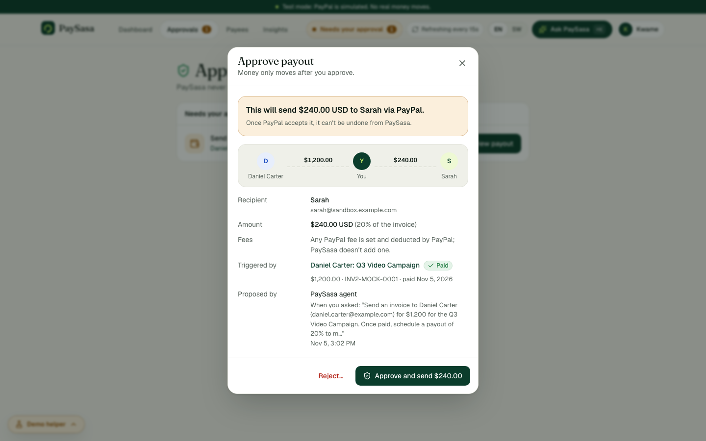
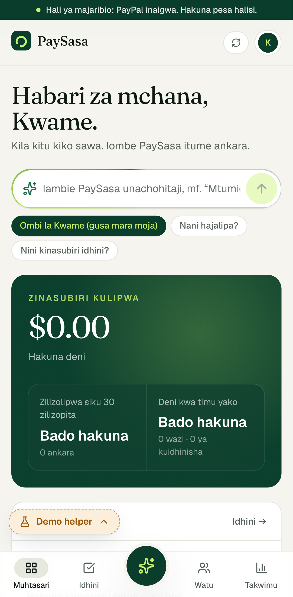
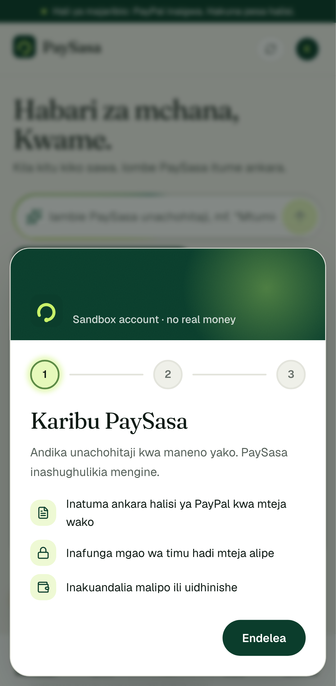
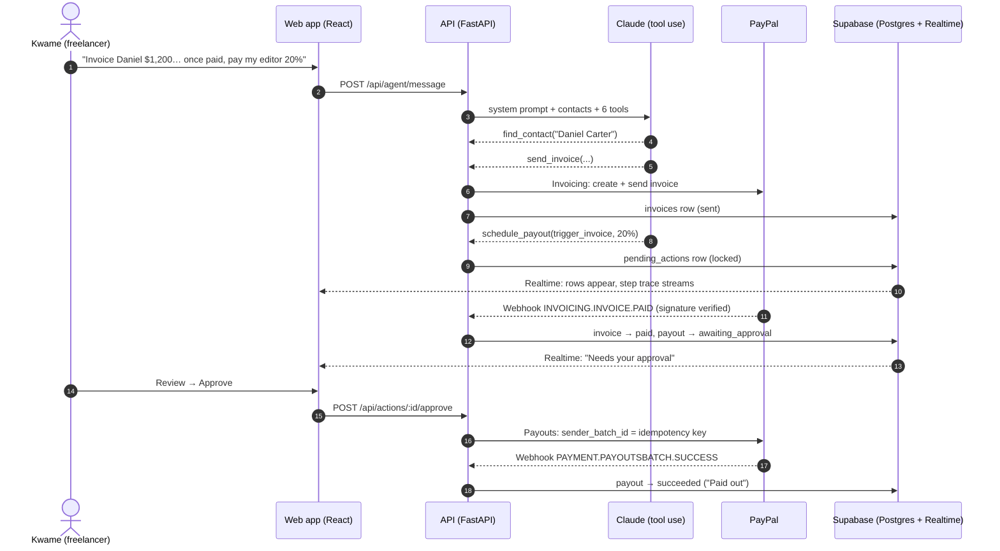
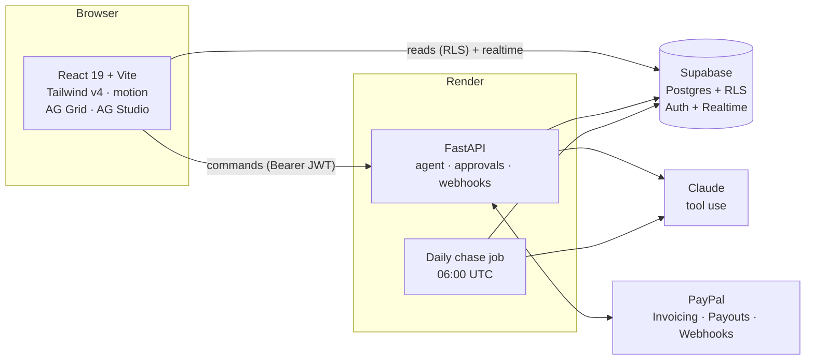

<div align="center">


# PaySasa

**Get paid by clients abroad. Pay your team. Skip the admin.**

An AI payments assistant for African freelancers. One sentence sends a PayPal invoice, waits for the client to pay, and lines up your collaborator's share. **No money moves until you approve it.**

[Live demo](https://paysasa-frontend.onrender.com) · [API health](https://paysasa.onrender.com/health)


-0b3d2c)




</div>

---

## Try it

| | |
|---|---|
| **Live app** | https://paysasa-frontend.onrender.com |
| **Test login** | `demo@paysasa.app` (password in the submission's testing instructions) |
| **Money** | PayPal sandbox only: no real money moves |

A short guided tour runs on first sign-in. Replay it any time at `/?tour=1` or from **account menu → Take the tour**.

---

## The problem

A video editor in Nairobi with clients in New York, London and Johannesburg does the same admin after every job:

- Makes an invoice in one tool and emails it from another.
- Opens PayPal every morning to see if the client has paid.
- Writes the awkward "just following up" email when they haven't.
- Works out the editor's 20% on a calculator, then types the payout by hand and hopes the email address is right.

Every step is manual, easy to forget, and the last one moves real money.

## What PaySasa does

| You say | PaySasa does | You stay in control because… |
|---|---|---|
| *"Invoice Daniel $1,200 for the Q3 campaign."* | Finds or creates the contact and sends a **PayPal invoice**. | Every step it takes is shown live, and the invoice appears on the dashboard. |
| *"When he pays, send Sarah 20%."* | Schedules a payout for $240.00 that is **locked to that invoice**. | The payout can't unlock until PayPal reports the invoice as paid. |
| *(Daniel pays)* | A **PayPal webhook** marks the invoice paid and unlocks the payout. | The payout waits for your approval. The assistant can't approve anything. |
| *(An invoice goes overdue)* | A daily job drafts a polite **reminder**. | You edit and send it, or discard it. Nothing goes to clients automatically. |
| *"Who hasn't paid?"* | Lists overdue and unpaid invoices. | Read-only: nothing changes. |

<table>
<tr>
<td width="50%"></td>
<td width="50%"></td>
</tr>
<tr>
<td><b>Dashboard.</b> It answers four questions in order: what's coming in, what needs me, where am I in the loop, and who pays me.</td>
<td><b>Assistant.</b> Every tool call is shown as a step, then as a live card that follows the real status.</td>
</tr>
<tr>
<td></td>
<td> </td>
</tr>
<tr>
<td><b>Approval.</b> One clear screen: who gets what, why, and from which payment.</td>
<td><b>Mobile and Kiswahili.</b> Thumb-reachable tabs, the full interface in Kiswahili, and the first-login guide.</td>
</tr>
</table>

---

## How it works



### PayPal integration

| PayPal capability | Where it's used | Code |
|---|---|---|
| **Invoicing** (create, send, get, remind) | `send_invoice` tool; reminder approval | `backend/server/app/agent/tools.py`, `app/actions/` |
| **Payouts** (batch payout, status) | Executed only after human approval; `sender_batch_id` is our idempotency key, so a retry can't pay twice | `app/actions/` |
| **Webhooks** (`INVOICING.INVOICE.PAID`, `…CANCELLED`, `PAYMENT.PAYOUTSBATCH.SUCCESS`, `…DENIED`) | Drive every state change; the signature is verified before anything is trusted | `app/webhooks/` |

All PayPal calls go through one interface, `PayPalAdapter` in [`paypal_contract.py`](backend/server/app/paypal_contract.py): invoices, reminders, payouts, payout status and webhook verification. `PAYPAL_ADAPTER=real` (the hosted app) uses the PayPal REST adapter against the PayPal sandbox. `PAYPAL_ADAPTER=mock` is an in-memory stand-in with the same states and webhook payloads, used by the test suite and for offline development.

### AI: an agent that acts, but can't spend

- **Model and loop:** Claude (`claude-sonnet-5-5`) with native tool use, running a multi-turn loop (`app/agent/run.py`).
- **Six typed tools**, each validated with Pydantic:
  - `find_contact`, `create_contact`
  - `send_invoice`
  - `schedule_payout`
  - `list_invoices`, `list_pending_actions`
- **Context:** the system prompt carries the user's contacts and nicknames ("my editor"), default currency and today's date. The model asks one short question instead of guessing an amount, currency or recipient.
- **Guardrails are in code, not the prompt:**
  - Amounts are capped (`MAX_AMOUNT_MINOR`).
  - Payouts are created as `locked` and can only unlock from a PayPal webhook.
  - There is **no tool that approves or executes a payout**.
- **Transparency:** each tool call is logged to `activity_log` and streamed to the UI as a step trace, then rebuilt from `agent_runs.tool_calls`.
- **Reminders:** the daily chase job asks Claude for a short, polite draft and checks that it mentions the right amount. A human edits and sends it (`app/agent/draft_reminder.py`).
- **Language:** the assistant replies in the language the user writes in, so a Kiswahili request gets a Kiswahili reply.

### AG Grid and AG Studio

- **Dashboard grids:**
  - Grouped by status, with **totals per currency** so USD and GBP never mix.
  - Filters, quick search, pinned columns and status cell renderers.
  - Live updates via `applyTransaction` with cell flash.
- **Insights (AG Studio):**
  - A self-serve dashboard over live data, with a 3-page default report.
  - Two **custom widgets**: a live approval queue that opens the real approval dialog, and a payout guardrail pipeline.
  - Uses our design tokens in light and dark mode, and saves your layout.

---

## Design, accessibility and language

- **Visual design:** "ledger on paper".
  - A warm paper canvas, forest ink and one lime accent saved for the main action.
  - Fraunces for headings and Geist for UI and numbers.
  - Hairline cards instead of heavy shadows.
  - The rationale and the references we adapted are in [`docs/design-revamp.md`](docs/design-revamp.md).
- **Usability:**
  - The assistant is a pop-up (⌘K, the header button or the mobile centre tab), so the dashboard keeps its full width.
  - Grids size to their data.
  - The first-login welcome and spotlight tour can be replayed at any time.
- **Accessibility:**
  - **axe reports 0 WCAG 2.1 A/AA violations** in light and dark mode on the landing, sign-in, dashboard, approval dialog, Insights and welcome tour.
  - Status is always icon + text + colour.
  - Full keyboard support, focus management in dialogs and the tour, and reduced-motion support.
  - No sideways scrolling at 360px.
- **Languages:** English and **Kiswahili**, which has over 100 million speakers across East and Central Africa. The switch covers the landing page, navigation, dashboard, assistant, approvals, status labels and the tour. It's saved per device and sets `<html lang>`.

---

## Architecture



- **Writes** go only through the API, using the service connection. **Reads** come straight from Supabase. Row-level security limits every user to their own rows. Realtime pushes `invoices`, `pending_actions`, `contacts` and `activity_log` changes, and the UI falls back to polling every 15 seconds.
- **Money** is stored as integer minor units, never floats. It's formatted per currency.
- **Payout state machine:** `locked → awaiting_approval → approved → executing → submitted → succeeded`, with `failed`, `rejected` and `cancelled` as exits (`app/transitions.py`). A double-click can't approve twice, a 409 conflict is reconciled with the server, and an unknown outcome never shows as "sent".

| Layer | Stack |
|---|---|
| Frontend | React 19, TypeScript, Vite 8, Tailwind CSS 4, TanStack Query, Radix UI, motion, AG Grid 36 (Enterprise), AG Studio 3 |
| Backend | Python 3.12, FastAPI, Pydantic 2, psycopg 3, Anthropic SDK |
| Data | Supabase (Postgres, Auth, Realtime, RLS) |
| Hosting | Render (static site + web service + cron) |
| Testing | Vitest + Testing Library, Playwright + axe-core, pytest |

### Repository layout

```
backend/
  server/app/         FastAPI app: agent/, actions/, webhooks/, jobs/, paypal/ (REST adapter), paypal_contract.py, paypal_mock/
  server/tests/       pytest (real Postgres, mock adapter)
  supabase/           migrations + demo seed
  render.yaml         API web service + daily cron
frontend/
  src/features/       dashboard, agent, approvals, insights (AG Studio), onboarding (tour), payees, settings
  src/lib/i18n.ts     English + Kiswahili strings
  e2e/                Playwright specs + in-browser fake backend
  render.yaml         static site
docs/                 design notes, screenshots
```

---

## Run it locally

**Requirements:** Node 20+, Python 3.12, and a Supabase project with `backend/supabase/migrations/0001_init.sql` applied.

```sh
# Backend
cd backend/server
python3.12 -m venv .venv && .venv/bin/pip install -r requirements.txt
cp .env.example .env          # DATABASE_URL, SUPABASE_URL, SUPABASE_SERVICE_ROLE_KEY, ANTHROPIC_API_KEY, LLM_MODEL
.venv/bin/uvicorn app.main:app --reload            # http://localhost:8000

# Frontend
cd frontend
npm install
cp .env.example .env          # VITE_API_BASE_URL=http://localhost:8000, VITE_SUPABASE_URL, VITE_SUPABASE_ANON_KEY
npm run dev                                        # http://localhost:3000
```

**Demo data:**
1. Sign up `demo@paysasa.app`.
2. Put Sarah's PayPal sandbox email in `backend/supabase/seed.sql` and run it. This creates Daniel Carter (client) and Sarah, "my editor" (contractor).

All environment variables are documented in [`backend/README.md`](backend/README.md) and [`frontend/README.md`](frontend/README.md).

### Tests

```sh
cd frontend
npm test                          # 42 unit/component tests: approval flow, money, status, agent parsing
npx playwright install chromium   # once
npm run e2e                       # the Kwame flow (desktop + mobile), axe WCAG A/AA (light + dark), 360px, first-login tour

cd backend/server
TEST_DATABASE_URL=postgresql://postgres@localhost:5432/postgres .venv/bin/python -m pytest
```

The end-to-end tests run against an in-browser fake of the backend and Supabase contracts, so they need no credentials. On machines with a non-US locale, run the frontend tests with `LC_ALL=en_US.UTF-8`. Otherwise `Intl` prints "US$" and the money assertions fail.

---

## Known limitations

- **Sandbox only:** PaySasa runs against the PayPal sandbox; going live needs PayPal production approval for Payouts.
- **Editing invoices:** there's no invoice edit or cancel yet, because the agent sends invoices immediately.
- **Currencies:** USD, GBP and EUR. There's no currency conversion.

## Team

- **Ian Karanja** ([@iankaranja13](https://github.com/iankaranja13))
- **Lance Munyao** ([@LancemDev](https://github.com/LancemDev))
- **Kevin Ojwang** ([@Kevin-0j](https://github.com/Kevin-0j))

Built in Nairobi for the PayPal AI Hackathon 2026.

## License

[MIT](LICENSE) © 2026 The PaySasa team.
